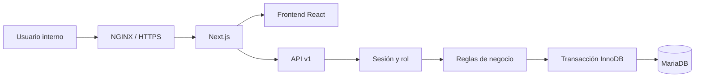
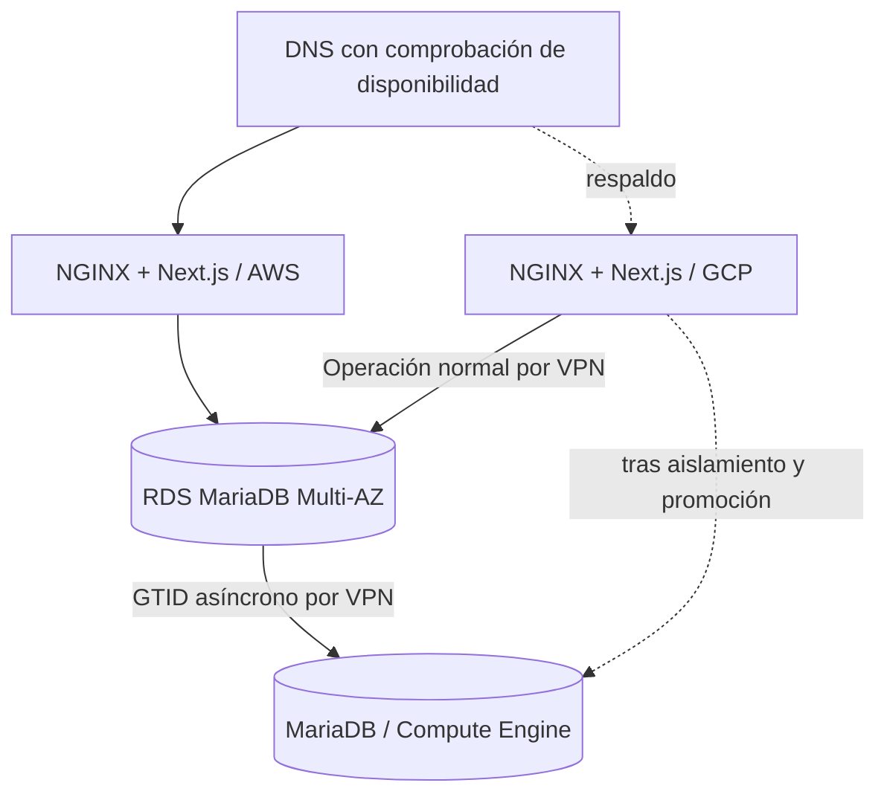

# Arquitectura de Polaris UES

## Aplicación

Un repositorio y una imagen desplegable permiten repetir la misma versión en AWS y GCP. Frontend y backend comparten tipos; credenciales y SQL permanecen en `server/`, protegido con `server-only`.

| Capa            | Responsabilidad                                              |
| --------------- | ------------------------------------------------------------ |
| Frontend        | Navegación, formularios, filtros, visualización y descargas. |
| API             | Sesiones, JSON, origen, códigos de error y contratos.        |
| Dominio         | Roles, reservas, FEFO, saldos, estados y auditoría.          |
| Repositorio     | Bloqueo, versión, idempotencia y commit/rollback.            |
| Infraestructura | Contenedores, proxy, redes y recursos cloud.                 |

## Flujo de trabajo

1. **Pedidos:** registra cliente y materiales; queda `Nuevo`.
2. **Despacho:** asigna lotes vigentes, reserva cantidades; queda `Asignado`.
3. **Despacho:** confirma físicamente lote y cantidad, registra una sola salida; queda `Confirmado`.
4. **Facturación:** registra la referencia emitida por otro sistema; queda `Facturado` sin otra salida.
5. **Inventario y Kardex:** entradas, bajas y correcciones con historial.

Las pantallas son colas sobre los mismos registros. Separar módulos no duplica pedidos ni movimientos. Pedidos permite consultar el avance y pasar al módulo correspondiente.

## Persistencia y concurrencia

- `app_users`: usuarios internos, hash scrypt, rol y estado activo.
- `application_state`: documento operativo y revisión, protegido por `SELECT ... FOR UPDATE`.
- `operations`: identificador único, usuario, hash de solicitud, revisión y tipo confirmado.
- `login_attempts`: límite compartido de intentos de acceso por usuario.

Cada escritura valida el cuerpo y rol, bloquea el estado, comprueba idempotencia y revisión, ejecuta el dominio y guarda estado y operación en una transacción. Una repetición idéntica no vuelve a aplicar el cambio. Reutilizar el identificador con otro contenido devuelve `409`.

El navegador conserva únicamente el identificador de una escritura incierta en almacenamiento local y coordina pestañas con Web Locks. Si pierde una respuesta, bloquea nuevos cambios y permite consultar el resultado. Una operación no encontrada en una réplica no prueba que nunca se confirmó en el primario; requiere conciliación técnica.

La persistencia facilita una migración verificable del dominio original, con dos límites: todas las escrituras comparten una fila y el cliente carga todo el estado. Para crecer: normalizar clientes, materiales, bodegas, lotes, pedidos, líneas, asignaciones, movimientos y auditoría; introducir repositorios por agregado y carga paginada. No se afirma capacidad de producción a gran escala.

## Acceso

| Rol           | Escrituras permitidas                                                                |
| ------------- | ------------------------------------------------------------------------------------ |
| Customer      | Crear pedidos y cancelar pendientes; representa atención comercial interna.          |
| Logística     | Asignar, confirmar, cancelar pendientes, recibir, dar de baja y corregir inventario. |
| Facturación   | Registrar referencia de factura en pedidos confirmados.                              |
| Administrador | Todas las operaciones y catálogos.                                                   |

Todos los usuarios activos son personal interno y consultan información operativa. No existe aislamiento por cliente externo. Un portal de compradores requerirá autorización por organización y registro.

La sesión usa HMAC, cookie HttpOnly, SameSite Lax y caducidad de ocho horas. En cloud requiere HTTPS y cookie Secure. El rol se consulta en MariaDB en cada solicitud. El selector del administrador cambia su vista; no concede permisos a otras cuentas. No se incluyen todavía recuperación de contraseña, MFA, administración web de usuarios ni revocación individual inmediata de cookies. Desactivar un usuario impide futuras solicitudes autenticadas.

## Arquitectura cloud objetivo

RDS Multi-AZ cubre fallos internos de AWS. La réplica GCP cubre pérdida de AWS mediante promoción controlada. No se mantiene escritura simultánea en ambas nubes.

**Corrección de la guía:** Cloud SQL ofrece MySQL, PostgreSQL y SQL Server; la réplica MariaDB se ejecutará en Compute Engine. La replicación GTID asíncrona permite retraso y pérdida de las últimas transacciones ante una caída total; no garantiza RPO cero. Referencias: [motores de Cloud SQL](https://docs.cloud.google.com/sql/docs/features), [GTID en MariaDB](https://mariadb.com/docs/server/ha-and-performance/standard-replication/gtid).

La aplicación funciona con MariaDB local. Los manifiestos y Terraform definen el despliegue objetivo. El laboratorio Docker depende de restablecer su motor. La infraestructura de las cuentas, replicación real, certificados, DNS y mediciones de recuperación todavía no se han desplegado ni probado.
